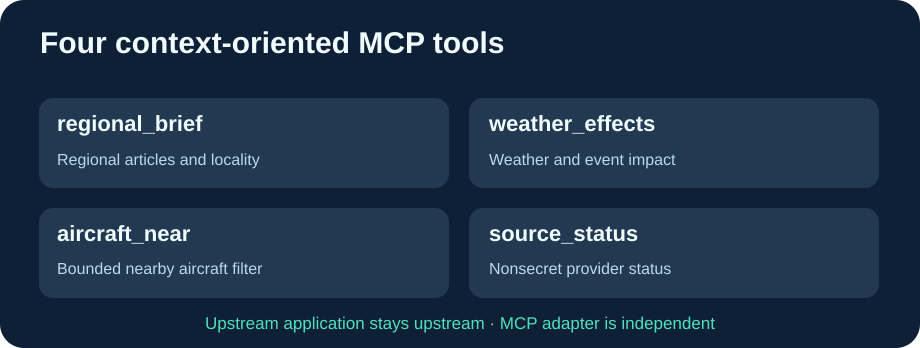

# Cloud9-GodsEye-MCP

**Quatre outils MCP de contexte pour Gods Eye View officiel, indépendants du serveur graphique.**

[English](README.md) · Français · [简体中文](README.zh-CN.md)

La version officielle [Gods Eye View](https://github.com/bilawalsidhu/gods-eye-view) possède déjà un MCP natif, mais celui-ci est limité au loopback en Docker et n'expose pas exactement nos quatre outils spécialisés. Cet adaptateur est **un petit service autonome**, pas un fork de l'application.

- regional_brief : informations régionales et actualité locale.
- weather_effects : météo et contexte logistique.
- aircraft_near : avions proches de coordonnées GPS.
- source_status : état limité des sources, sans clés d'accès.

Le serveur est **strictement en lecture seule**, sans opération financière réelle.

Les modifications Cloud9 éliminent les adresses LAN privées du code, ajoutent GODS_EYE_BASE_URL et MCP_ALLOWED_HOSTS, et confient les mises à jour à GitHub Actions. Quatre schémas MCP, une véritable connexion HTTP, un backend fictif et les contrôles anti-rebinding sont testés avant toute publication GHCR.

## Installation

~~~bash
git clone https://github.com/GodsQuantum/Cloud9-GodsEye-MCP.git
cd Cloud9-GodsEye-MCP
cp .env.example .env
docker compose -f compose.example.yaml up -d
~~~

Le backend du globe peut fonctionner **à la demande** : l'adaptateur reste actif mais n'oblige pas à garder un second serveur graphique allumé. Le voyant Docker healthy du MCP seul ne prouve pas que le backend graphique fonctionne.

Aucun secret ni réseau personnel n'est publié. Licence MIT pour le connecteur et attribution indépendante pour l'application upstream.
