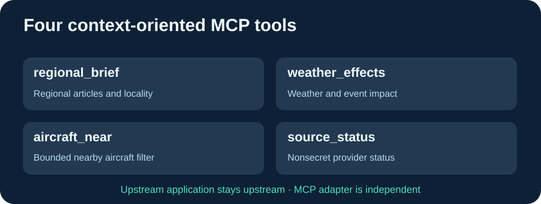

<h1 align="center">Cloud9-GodsEye-MCP</h1>

<strong>Four remote-friendly context tools for official Gods Eye View, independently maintained.</strong>

English · <a href="README.fr.md">Français</a> · <a href="README.zh-CN.md">简体中文</a>

The [official Gods Eye View](https://github.com/bilawalsidhu/gods-eye-view) v0.3 includes its own **loopback-restricted** MCP interface. This lightweight companion is **not a fork of that application**: it preserves four specialist context tools for another container or trusted MCPProxy that the upstream MCP surface does not expose identically.

## Tools preserved

| Tool | What it returns |
|---|---|
| regional_brief | Locality, regional news and a bounded articles list |
| weather_effects | Weather effects useful to logistics and event risk |
| aircraft_near | Aircraft near coordinates, locally filtered from the configured provider |
| source_status | Safe subset of provider availability, never provider keys |

All tools are **read-only**, return contextual evidence only, and do not authenticate or modify real brokerage/financial accounts.

## Portable distribution improvements

- No hardcoded personal LAN address, hostname or source domain: configure GODS_EYE_BASE_URL and MCP_ALLOWED_HOSTS explicitly.
- Docker image built in GitHub Actions, not on the production server. GitHub periodically refreshes the Python MCP SDK and checks **all four existing tool schemas**.
- Native Streamable HTTP, strict DNS rebinding protection; unknown Host rejected with HTTP 421.
- CI uses a synthetic upstream API test fixture and a real client MCP HTTP handshake, with no external keys or network access.
- Small rootless container, read-only compatible.

## Example

~~~bash
git clone https://github.com/GodsQuantum/Cloud9-GodsEye-MCP.git
cd Cloud9-GodsEye-MCP
cp .env.example .env
docker compose -f compose.example.yaml up -d
~~~

Use your existing, independently managed Gods Eye View source application. The backend may be run on demand via its own systemd socket; this MCP remains available without keeping the large globe backend in memory. A readiness check on the MCP container only confirms its own socket; verify backend availability separately.

**Never expose the MCP endpoint publicly without an authenticated gateway.** Keep your internal backend URL and Host allowlist in an untracked environment file. All adapter code is MIT; Gods Eye View upstream and its third-party data retain their separate licenses.
