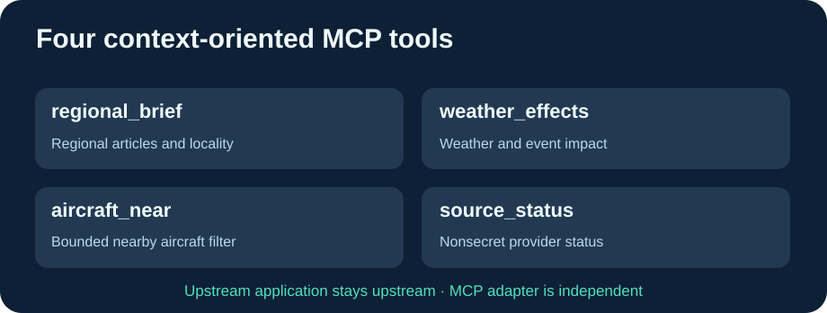

# Cloud9-GodsEye-MCP

**为官方 Gods Eye View 提供四个独立的环境情报 MCP 工具，无需修改原应用。**

[English](README.md) · [Français](README.fr.md) · 简体中文

[Gods Eye View](https://github.com/bilawalsidhu/gods-eye-view) 新版本已经有官方 MCP，但 Docker 中仅允许 loopback，且缺少这里四个工具的完全同等功能。本项目是**独立的只读适配器**，不克隆应用源码。

- regional_brief：本地新闻与区域概况。
- weather_effects：天气与物流事件影响。
- aircraft_near：坐标附近的航空器。
- source_status：经过脱敏的数据源状态。

Cloud9 包装层不包含任何个人 IP、密钥或账户。通过 GODS_EYE_BASE_URL 和 MCP_ALLOWED_HOSTS 设置您自己的后端地址与授权主机。

GitHub Actions 使用真实 HTTP MCP 测试与模拟后端验证四个工具输入 Schema，以及未知 Host 的 HTTP 421 拒绝逻辑。通过后才发布 GHCR 镜像，服务器无需本地编译。

## 安装

~~~bash
git clone https://github.com/GodsQuantum/Cloud9-GodsEye-MCP.git
cd Cloud9-GodsEye-MCP
cp .env.example .env
docker compose -f compose.example.yaml up -d
~~~

图形后端可通过 systemd socket 按需启动，适配器本身保持轻量级在线。MCP 健康状态并不能单独证明后端已启动。

连接器采用 MIT 许可证，上游应用和第三方数据分别保留原许可证。
